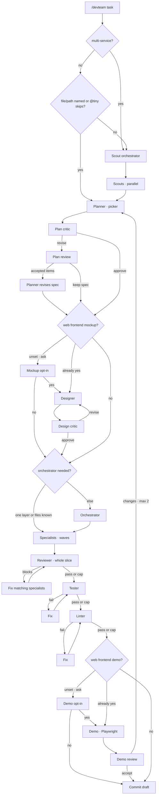
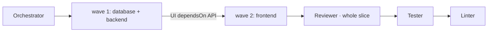

<div align="center">

# pi-dev-team

**One command. Full team. `/devteam` plans, builds, tests, and demos.**

Plans with scouts · Builds the slice · Tests + lints · Optional live demo

[](https://pi.dev)
[](https://github.com/coder/oh-my-pi)
[](https://nodejs.org)
[](./LICENSE)
[](#tests)

[Quick Start](#-quick-start) · [How it Works](#-how-it-works) · [Commands](#-commands) · [Config](#-config) · [Stack Skills](#-stack-skills)

</div>

---

## ⚡ Quick Start

```bash
# Pi
pi install https://github.com/W4775/pi-dev-team
# OMP
omp plugin install github:W4775/pi-dev-team
```

Then in any Pi/OMP session:

```text
/devteam Add a settings page for profile and notifications
```

Answer the planner's picker → review the critic → watch specialists build the slice → one review, then tests. Done.

> Previous jobs persist. `/devteam list` to resume. Each session owns its own run.

---

## 🧠 How it Works

**Scout → Plan → Build the slice → Prove once.**

| Step | What happens | Who |
|------|--------------|-----|
| **Scout** | Planner-orchestrator writes 2–4 scout items; read-only scouts map the repo. For non-multi-service projects, a named file or source path skips scouting; otherwise `@tiny` may decide to skip. Multi-service projects always scout | children |
| **Plan** | Planner grills you (picker), writes spec; critic may pause for Accept / Reject | you + child |
| **Design** | After the spec is approved, web+frontend jobs **ask** unless `wantMockup` was already set | you |
| **Build** | Implementation orchestrator splits **this slice** into file-disjoint work items — **skipped** when there is one layer, or every needed layer already has `filesToChange`. `database` / `backend` / `frontend` / `general` children run in waves (cap 6). `dependsOn` is the only ordering — not a layer waterfall | children |
| **Prove** | Reviewer on the **whole slice**, then tester, then linter. Pass/fail comes from **exit codes**, `[block]` findings, and (when those miss) `@tiny`. Each parks after 3 failed fix rounds until `/devteam continue`. Environment/transient bash failures park instead of sending implementors. Reviewer and fixer implementors use `@slow` | children |
| **Demo** | After lint, web+frontend jobs **ask** unless `wantDemo` was already set. Best-effort headed Playwright, then you accept or request changes (max 2 demos) | you + child |
| **Ship** | Drafts a conventional commit — *never commits* | child |

Planner and designer stay in your session. Everyone else is an isolated child (`pi -a` / `omp --yolo` on trusted projects, with `@smol` scout/tester/linter, `@task` implementors/critics, `@slow` reviewer and fix rounds, `@commit` for the commit draft). For unassigned children without a handoff, completion is inferred from the notebook first, then `@tiny`; if both miss, the job stops. Assigned implementors must mark their item done with `implementor_done`; assigned scouts need saved findings. Assigned items do not use that inference fallback.

---

## 🎮 Commands

| Command | Does |
|---------|------|
| `/devteam <task>` | Start a new job |
| `/devteam continue` | Resume this step, or proceed past a parked cap |
| `/devteam retry [id …]` | Reopen failed work items on this job and return to implement. Omit ids to retry every failed item |
| `/devteam list` | Show saved jobs |
| `/devteam continue 2` | Jump to job #2 at its saved stage |
| `/devteam skip` | Skip this step. During implement, remaining items go to review |
| `/devteam stop` | Abort the current child / step |
| `/devteam status` | Show notebook paths |
| `/devteam mockup` | Open the HTML mockup |
| `/devteam clear` | Clear current job state and its job artifact directory |

At mockup or demo opt-in, answer **yes** or **no** in chat (or skip). Caps (review / test / lint / design-critic) park; continue and skip both proceed.

Before clearing, back up any needed artifacts: clear removes the job's artifact directory recursively, including mockups, demo scripts, and screenshots.

On POSIX, stopping a child sends SIGTERM to its process group and escalates to SIGKILL after two seconds. On Windows, termination covers the direct child only.

`/devteam continue` stays on the current stage. It does not rewind from review, QA, or the commit draft. `/devteam retry` is the recovery for failed work items still stored on that job.

Failed scouts retry automatically up to their cap; exhausted or interrupted work stays parked instead of advancing without research. Use `/devteam continue` to retry or `/devteam skip` to proceed without it. Plan critique requires an interactive decision; without a picker, resume with UI or skip to keep the existing spec.

If a crash leaves a state `.lock` directory behind, stop all devteam processes before removing that directory. Lock timeouts fail closed to protect run state.

If a run remains busy after a crash, stop all parent and child processes for that job and back up its canonical run JSON (shown by `/devteam status`, not the workflow-state alias). Remove `pipelineOwner`, set `pipelineLocked` to `false`, and use `/devteam continue <job-id>` to requeue interrupted items. Do not clear ownership while any job process is alive.

---

## 🔄 Pipeline



Design, review, test, and lint **park after their cap** (2 design rejects, 3 fix rounds). `/devteam continue` proceeds (design → implement, review → tester, test → lint, lint → demo or commit). `/devteam skip` does the same at those caps.

Demo is best-effort: the service needs an agreed serve command, plus project-local Playwright and its browser already installed. On Linux without a display, the demo role uses `xvfb-run` if available; a virtual display is not visible on the user's screen. Missing prerequisites or a failed demo are recorded as notes, not pipeline failures.

<details>
<summary>Inside the build: specialists, not a layer factory</summary>



Example: schema and API have disjoint files, so they share a wave; UI lists `dependsOn` the API item, so it waits. If all three are disjoint and have no `dependsOn`, they run in one wave (up to `parallel`, default 3, cap 6).

- `layer` on an item only picks the specialist (`database` / `backend` / `frontend` / `general`) and its write globs.
- Disjoint file lists run in the same wave, including across layers.
- `dependsOn` is the only ordering (migration before route, route before UI).
- No `workItems`? Needed specialists run in sequence, then the same single review.

</details>


## ⚙️ Config

Create `.pi/devteam.json` (or `.omp/devteam.json` on OMP) — trusted projects only:

```json
{
  "skills": { "frontend": ["angular"], "backend": ["dotnet"], "database": ["postgres"] },
  "paths": { "frontend": ["src/app/**"] },
  "services": [{ "name": "api", "root": "services/api", "layer": "backend", "test": ["go test ./..."] }],
  "parallel": 3,
  "maxToolCalls": 200,
  "models": { "scout": "@smol", "reviewer": "@slow" }
}
```

- `skills` — catalog IDs from `catalog/stacks.json` (3 per child max, sparse-cloned)
- `services` — auto-detected via `go.mod`/`package.json`/`.csproj`; override when guess wrong
- `models` — alias per role (OMP: `@smol` scout/tester/linter, `@task` implementors/critics, `@slow` reviewer and fix rounds, `@commit` commit message; Pi uses session model)
- `parallel` — how many specialists may run at once when file lists do not collide (default 3, cap 6)
- `maxToolCalls` / `childIdle` / `repeatToolAbort` — tune budgets


---

## 🧩 Stack Skills

Bundled: `implement` + `tdd`. Plus official stacks (React, Vue, Angular, React Native, .NET, Blazor, Postgres, EF Core…) — not vendored, fetched on demand.

Progress: one-line widget `step · role · 1:23` + 40-line transcript blocks per role.

Default tool-call budgets: `200` for database/backend/frontend/general implementors, reviewer, tester, linter, and demo; `40` for scouts; `80` for other isolated roles. `childIdle` defaults to `480s`, `repeatToolAbort` to `8`.

---

## 🔒 Permissions

| Role | Can |
|------|-----|
| Planner / Critics / Reviewer | Read-only |
| Designer | Planner's read, search, bash, ask, state and handoff tools, plus `devteam_mockup`; no repository edits |
| Implementors | Edit tree, no `.env`/keys, no `git commit`, no `rm -rf` / git rewrite / package installs / curl / sudo |
| Demo | `serve` + Playwright, writes `demo/` only |

Optional per-layer `paths` globs further restrict writes.

These checks are guardrails, not a security sandbox: shell commands and project scripts can perform actions beyond the tool-level restrictions. Run only trusted projects and agents with appropriate OS permissions.

Trust is host-provided: if the trust API is unavailable or throws (including on hosts without it), the extension assumes trusted. OMP children may then run with `--yolo`; use only trusted projects.


---

## 📦 Install Details

**Pi** — Node 22+:

```bash
pi -e ./src/index.ts          # dev
pi install https://github.com/W4775/pi-dev-team
```

**OMP** — don't `omp plugin link` a checkout with nested `.git` on older OMP:

```bash
omp plugin install github:W4775/pi-dev-team
omp plugin install /abs/path/to/pi-dev-team  # from clone
```

Upgrade: `omp plugin uninstall pi-dev-team && omp plugin install github:W4775/pi-dev-team`

OMP children use `PI_SUBPROCESS_CMD` / `omp --yolo` + `DEVTEAM_ROLE`.

---

## ✅ Tests

Development tooling requires Node `^22.18.0 || ^24.11.0 || >=26.0.0` for Vite+. The extension itself supports Node 22+.

```bash
npm test          # unit + e2e harness, no Pi needed
npm run lint      # Vite+ lint (Oxlint)
npm run fmt:check # Vite+ format check (fix: npm run fmt)
```

Covers: permissions, per-session state, teardown, slice waves, review-once, fail-closed handoffs, block vs note, stack detection, model tiers, transcript caps.

---

<div align="center">

MIT for pi-dev-team · See `NOTICE` for skill licenses (Matt Pocock MIT, Anthropic Apache-2.0)

*PRs welcome — keep it thin, keep it tested.*

</div>